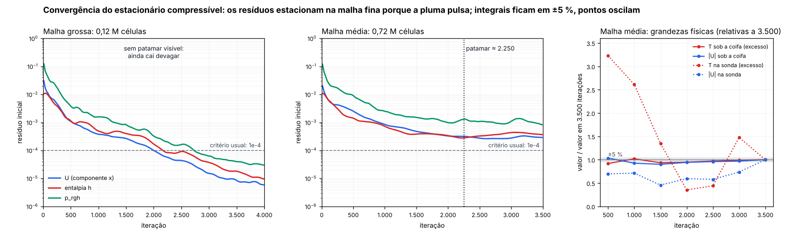

# Quanto custa o caso 3D completo (coifa A, estacionário)

## Resumo

- Na sua máquina (Xeon E-2176M, 6 processos): malha média (0,72 M células) **≈ 1,6 h**; intermediária (1,5 M) **≈ 4,7 h**; produção (3,13 M) **≈ 13,4 h** (6,7 a 30,8 h). Cada 1.000 iterações levam 2,4 h na malha de produção.
- Base do tempo por iteração: extrapolado pela banda de memória (65 GB/s na nuvem com 4 processos; 26 a 36 GB/s no notebook com 6); ainda não foi medido na sua máquina.
- O caso não foi rodado até o fim. Mediu-se a malha, o custo por iteração e a memória nas três malhas, e o comportamento dos resíduos e de grandezas físicas até 3.500 iterações na malha média; o resto é extrapolação, com a faixa informada.
- **O número de iterações é a maior incerteza (fator 0,7 a 1,5).** A pluma quente oscila: na malha média os resíduos estacionam em torno de 3e-4 e o critério usual de 1e-4 não é atingido, de modo que o fim da simulação se decide pelo patamar dos resíduos e pela média de grandezas físicas, não por uma tolerância.
- Memória não é limite: o pico previsto para a malha de produção é de cerca de 5,5 GB, contra os 64 GB do notebook.

## O que foi medido na nuvem (Xeon 2,1 GHz, 4 núcleos, 15 GB; OpenFOAM ESI v1912)

| Malha | Células | 1 proc. | 2 proc. | 3 proc. | 4 proc. | Memória (4 proc.) |
|---|---:|---:|---:|---:|---:|---:|
| grossa | 122.318 | 0,35 s | 0,19 s | 0,13 s | 0,10 s | 0,4 GB |
| média | 719.017 | 2,93 s | 1,53 s | 0,95 s | 0,76 s | 1,4 GB |
| produção | 3.132.008 | 25,99 s | 9,37 s | 5,53 s | 4,30 s | 5,3 GB |

Segundos por iteração (mediana de 30 a 40 iterações). A geração da malha de produção (blockMesh + snappyHexMesh + patches) levou **182 s** com um processo e 3,8 GB. O tempo por iteração cresce com as células elevadas a 1,16.

## Quantas iterações: o que os resíduos e os monitores mostram

- Malha grossa (122.318 células, 4.000 iterações rodadas): os resíduos ainda caem devagar no fim da execução (≈ Ux 8e-6, h 1e-5, p_rgh 4e-5); não há patamar visível. Com o critério usual (1e-4) ela convergiu em 2.165 iterações e com o rigoroso (1e-5), em 3.963.
- Malha média (719.017 células, 3.500 iterações rodadas): os resíduos estacionam a partir de ≈ 2.250 iterações, nos níveis Ux 3e-4, h 4e-4, p_rgh 1e-3.

- O custo por iteração é estável durante a execução: grossa: −8,3 % entre o começo e a segunda metade; média: 2,8 % entre o começo e a segunda metade.

Grandezas físicas na malha média a cada 500 iterações (T em K; U em m/s):

| Iteração | T média sob a coifa | \|U\| média sob a coifa | T média do ambiente | T na sonda (0,5 m sobre a ilha) | \|U\| na sonda |
|---:|---:|---:|---:|---:|---:|
| 500 | 294,90 | 0,70 | 293,39 | 296,65 | 0,56 |
| 1.000 | 295,09 | 0,63 | 293,37 | 295,98 | 0,57 |
| 1.500 | 294,93 | 0,61 | 293,35 | 294,61 | 0,37 |
| 2.000 | 294,95 | 0,64 | 293,36 | 293,53 | 0,48 |
| 2.500 | 295,00 | 0,65 | 293,36 | 293,63 | 0,47 |
| 3.000 | 295,04 | 0,66 | 293,35 | 294,75 | 0,59 |
| 3.500 | 295,05 | 0,68 | 293,34 | 294,23 | 0,81 |

De 1.000 a 3.500 iterações, a variação (± metade da amplitude relativa) é de ±4 % no excesso de temperatura sob a coifa e ±5 % na velocidade média sob a coifa, mas de ±94 % e ±40 % nos valores da sonda: a pluma pulsa e um valor pontual do último passo não representa o escoamento; vale a média de uma janela de iterações. O excesso de temperatura médio do ambiente (uma fração de grau) ainda cai devagar.

**Critério adotado para o fim da simulação:** patamar dos resíduos + 1.000 iterações para calcular a média das grandezas de interesse. Na malha média isso dá 3.500 iterações (2.250 até o patamar + 1.000 de média, arredondado para cima). Para as malhas maiores, adotou-se N ∝ células^0,25 (hipótese de engenharia: com a malha grossa convergindo a 1e-5 e a média estacionando em 3e-4, as duas medidas não permitem ajustar o expoente), com faixa de ×0,7 a ×1,5.

## Estimativa para o seu notebook (Xeon E-2176M, 6 processos, 64 GB)

Base: extrapolado pela banda de memória (65 GB/s na nuvem com 4 processos; 26 a 36 GB/s no notebook com 6); ainda não foi medido na sua máquina. Faixas = pior caso … melhor caso (combinam a incerteza do tempo por iteração com a do número de iterações); o valor central vem do modelo.

| Malha | Células | Memória | s/iteração | Iterações adotadas (faixa) | Duração | Faixa |
|---|---:|---:|---|---|---|---|
| média | 719.017 | 1,4 GB | 1,1 a 2,4 (1,6) | 3.500 (2.450 a 5.250) | **1,6 h** | 51 min a 3,6 h |
| intermediária | 1.500.000 | 2,9 GB | 2,6 a 5,7 (3,7) | 4.500 (3.150 a 6.750) | **4,7 h** | 2,4 a 10,8 h |
| produção | 3.132.008 | 5,5 GB | 6,2 a 13,4 (8,7) | 5.500 (3.850 a 8.250) | **13,4 h** | 6,7 a 30,8 h |

A duração inclui a geração da malha e 5 minutos de pós-processamento. O notebook tem menos banda de memória que esta nuvem, e é ela que limita o solver em malha grande: por isso o tempo sobe mais do que a diferença de clock sugere.

## Quanto confiar

- **Custo por iteração na nuvem: alta confiança.** A malha de produção foi medida (não extrapolada) e o modelo de potência, ajustado só com a grossa e a de produção, prevê a média com erro de 2,7 % (previsto 0,78 s, medido 0,76 s).
- **Passagem para o notebook: confiança média** enquanto não houver medida na sua máquina. A incerteza vem da banda de memória (26 a 36 GB/s é a faixa de um DDR4-2666 em dois canais) e de efeitos de cache e do WSL2; o tempo por iteração fica entre −29 % e +54 % em torno do valor central. Rodar `bench_maquina.py` (cerca de 10 minutos) troca isso por medida e reduz a faixa para cerca de −10 % a +15 %.
- **Número de iterações: confiança média a baixa.** O patamar foi medido na malha média; para a de produção é extrapolação. Mudar as hipóteses do caso (carga térmica, reposição, abertura de equilíbrio) pode mudar o comportamento da pluma e o patamar.
- **Não estimado:** simulação transiente da fumaça (LES ou URANS). Como ordem de grandeza, 60 s físicos com passo de 0,01 s e duas correções por passo equivalem a cerca de 12 mil iterações do estacionário, ou seja, 2,2 vezes as iterações adotadas para a malha de produção, sem contar o pós-processamento.

## Recomendação

1. Comece pela malha média (1,6 h no notebook): ela já resolve a pluma e os captores e valida a configuração do caso antes de gastar uma noite.
2. Para o estudo de captura de verdade, use a malha intermediária (≈ 1,5 M células, 4,7 h) ou a de produção (13,4 h, deixada rodando durante a noite), depois de confirmar as hipóteses de carga térmica e reposição.
3. Grave as grandezas de interesse (taxa de captura, temperatura na sonda) a cada iteração e pare quando a média móvel de 1.000 iterações variar menos que a tolerância que você aceitar; não pare pelo resíduo.
4. Rode antes a calibração: ela leva 10 minutos e substitui a extrapolação por medida.

## Como trocar a extrapolação por medida

Rode `python3 openfoam/bench_maquina.py --np 1,2,4,6` no notebook (≈ 10 min, gera a malha média e mede 30 iterações) e mande o resumo impresso: `estimar_duracao.py --usuario bench_maquina.json` recalcula a tabela com o seu tempo por iteração.
